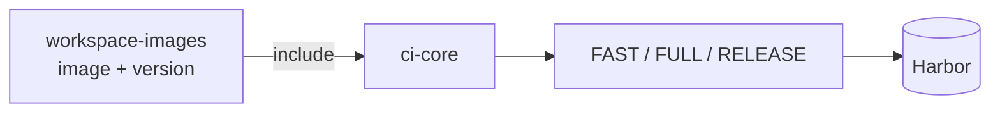
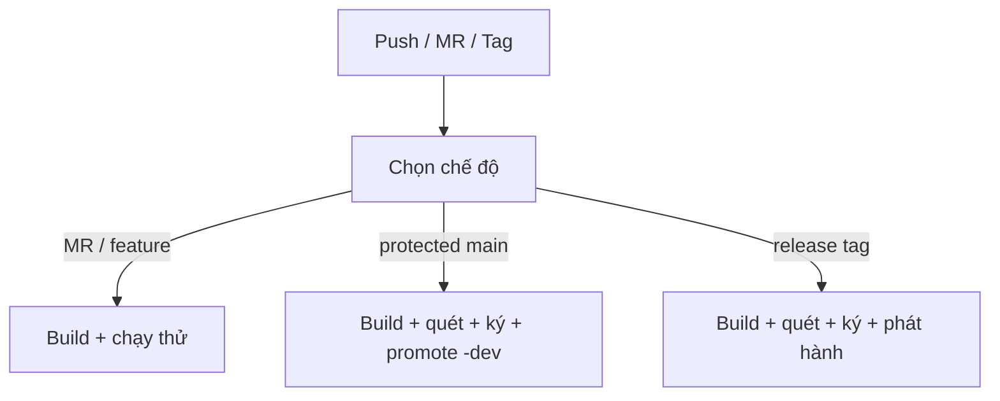
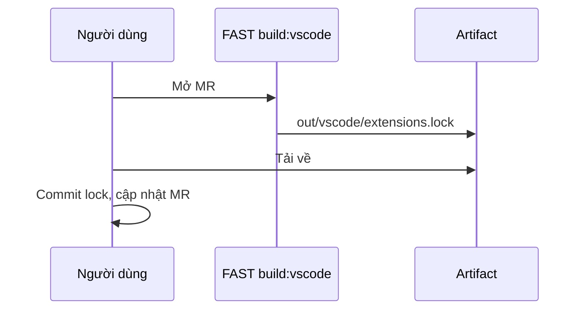

# Workspace Images

> Nơi khai báo image cho pipeline `ci-core`: `images.json`, Dockerfile và runtime check. Engine CI/CD nằm ở [`ci-core`](../ci-core).

## 1. Hiểu nhanh

- `workspace-images` = nơi định nghĩa image và version.
- `ci-core` = bộ máy build, quét lỗ hổng, ký và phát hành.

Bạn chỉ cần biết: **thêm/sửa image trong `images/<id>/`; khai báo metadata trong `images.json`; mở MR để chạy FAST**.



## 2. Cấu trúc repo

```text
workspace-images/
├── .gitlab-ci.yml       # workflow rules + include ci-core
├── images.json          # danh sách image, version, bật/tắt
├── shared/              # file dùng chung
└── images/
    └── <image-id>/
        ├── Dockerfile
        ├── configs/     # cấu hình/lockfile (nếu có)
        ├── scripts/     # script cài đặt
        └── validate/    # script kiểm tra khi chạy thật
```

Ví dụ VS Code:

```text
images/vscode/
├── Dockerfile
├── configs/extensions.txt       # danh sách extension ID
├── configs/extensions.lock      # pin phiên bản
├── scripts/install-extensions.sh
└── validate/runtime.sh
```

## 3. `images.json`

Mỗi image là một entry. Các trường chính:

| Trường | Ví dụ | Ý nghĩa |
|---|---|---|
| `id` | `vscode` | Tên job và thư mục artifact `out/vscode/`. |
| `repository` | `vscode` | Tên repository trong Harbor. |
| `version` | `0.1.0` | Version của image; tag sinh tự động từ nó. |
| `enabled` | `false` | Chỉ `true` thì FULL build. |
| `depends_on` | `[]` | File shared mà image dùng, để rebuild đúng phạm vi. |
| `extension_lock` | xem dưới | Chỉ cần với VS Code. |
| `runtime_check` | `images/vscode/validate/runtime.sh` | Script kiểm tra image sau khi build. |

Ví dụ VS Code:

```json
{
  "id": "vscode",
  "repository": "vscode",
  "context": ".",
  "dockerfile": "images/vscode/Dockerfile",
  "platform": "linux/amd64",
  "enabled": false,
  "version": "0.1.0",
  "depends_on": [],
  "extension_lock": {
    "manifest": "images/vscode/configs/extensions.txt",
    "lock": "images/vscode/configs/extensions.lock",
    "generated": "/opt/dwf-vscode/extensions.lock.generated"
  },
  "runtime_check": "images/vscode/validate/runtime.sh"
}
```

## 4. Chạy pipeline

| Sự kiện | Chế độ | Kết quả |
|---|---|---|
| Merge request | FAST | Build + chạy thử local; không push |
| Push `feature/*`, `bugfix/*` | FAST | Build image bị ảnh hưởng |
| Protected `main` | FULL | Build toàn bộ image bật; gắn tag `-dev` |
| Protected release branch | FULL | Gắn tag `-rc` |
| Protected image tag | RELEASE | Tag cố định + GitLab Release |

Tag sinh từ `version` trong `images.json`. Ví dụ `1.2.0`:

- protected `main` → `1.2.0-dev`
- protected `release/vscode/v1.2.0` → `1.2.0-rc`
- protected tag `vscode/v1.2.0` → `1.2.0`



## 5. VS Code lock

VS Code cần file `extensions.lock` đã cài thật, không tự invent version.

- FULL/RELEASE: lock phải khớp `extensions.txt`.
- FAST: thiếu lock → pipeline resolve và xuất `out/vscode/extensions.lock`.

Tải artifact: mở **child pipeline** → job `build:vscode` → **Assets / Artifacts** → **Download**. Commit file lock vào repo rồi cập nhật MR.



## 6. Thêm hoặc sửa image

1. Tạo branch `feature/<image>` hoặc `bugfix/<image>`.
2. Thêm/sửa `images/<id>/Dockerfile`, scripts, config, validate.
3. Cập nhật `images.json`: `id`, `repository`, `version`, `enabled`, `depends_on`.
4. Mở MR để FAST chạy.
5. Merge vào protected `main` để FULL chạy.
6. Cần phát hành: tạo protected release branch hoặc image tag.

Quy tắc ngắn:

- Không hardcode proxy; dùng GitLab CI/CD Variables.
- Không dùng tag `latest` cho production.
- Không để secret trong Dockerfile/config.
- Không sửa cấu hình runner từ repo này.

## 7. Lỗi thường gặp

| Thấy gì | Thường do | Xử lý |
|---|---|---|
| Lock thiếu/thừa ID | Chưa commit lock | Tải artifact, commit lock. |
| Pull image DNS timeout | Runner không tới registry | Kiểm tra runner/DinD. |
| Không thấy artifact | Sai pipeline cha/con | Vào child job `build:<image>`. |

## 8. Test nhanh một image

```bash
cd workspace-images
docker build -f images/ubuntu/Dockerfile -t workspace-ubuntu-test .
docker run --rm workspace-ubuntu-test <command-cần-kiểm>
```

Nếu image có `validate/runtime.sh`, nên chạy qua engine để đúng môi trường kiểm tra.

## 9. Biến môi trường

Cấu hình ở GitLab **Settings → CI/CD → Variables**:

- `CI_CORE_PROJECT`, `CI_CORE_REF` — trỏ core đúng phiên bản.
- `HARBOR_REGISTRY`, `HARBOR_PROJECT` — nơi push image.
- `HARBOR_USER`, `HARBOR_PASSWORD` — robot push, đặt **Protected**.
- `COSIGN_PRIVATE_KEY`, `COSIGN_PASSWORD` — khóa ký.
- `HTTP_PROXY`, `HTTPS_PROXY`, `NO_PROXY` — chỉ khi môi trường cần proxy.
- `BUILDX_BUILDER_NETWORK` — mặc định để trống.

## 10. Đọc thêm

- [`../ci-core`](../ci-core) — engine và script
- [`../ci-core/docs/PIPELINE_GUIDE_VI.md`](../ci-core/docs/PIPELINE_GUIDE_VI.md) — chi tiết vận hành
