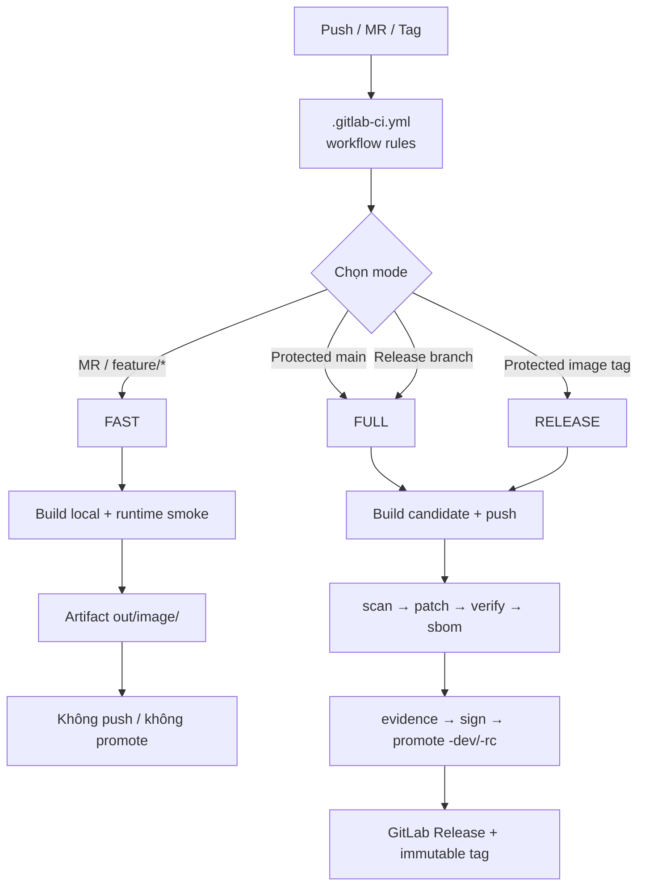
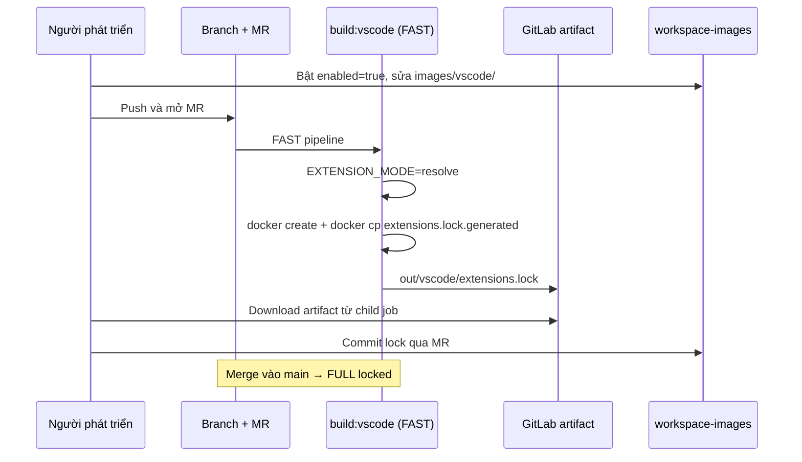

# Workspace Images

> **Consumer repo** của pipeline `ci-core`. Repo này chứa **image inventory, Dockerfile và runtime hook**; còn engine CI/CD nằm ở [`ci-core`](../ci-core).
>
> Trong tài liệu này, thuật ngữ GitLab/Docker được giữ tiếng Anh; phần hướng dẫn viết bằng tiếng Việt.

## 1. repo này làm gì

- `images.json` — danh sách image: ID, version, trạng thái `enabled`, lock metadata, runtime check.
- `images/<id>/Dockerfile` — định nghĩa từng image.
- `images/<id>/scripts/` — script cài đặt, custom startup.
- `images/<id>/validate/` — script kiểm tra khi container đã build.
- `shared/` — file dùng chung cho nhiều image.
- `.gitlab-ci.yml` — workflow rules; include parent template từ `ci-core`.

Khi bạn push, mở MR hoặc tạo tag, `.gitlab-ci.yml` trỏ vào `ci-core`. Engine sẽ chọn FAST/FULL/RELEASE và build các image được chọn.

## 2. Cấu trúc thư mục

```text
workspace-images/
├── .gitlab-ci.yml              # workflow rules + include ci-core
├── images.json                 # catalog image, version, enable, hooks
├── shared/                     # nội dung dùng chung
│   └── browser/
│       ├── cleanup.sh
│       └── ublock_extension.json
└── images/
    ├── ubuntu/
    │   ├── Dockerfile
    │   ├── scripts/            # install scripts theo công cụ
    │   └── validate/           # runtime validation hooks (nếu có)
    ├── chrome/
    ├── chrome-gpu/
    ├── firefox/
    ├── opera-browser/
    ├── tor-browser/
    └── vscode/
        ├── Dockerfile
        ├── configs/
        │   ├── extensions.txt       # danh sách extension ID
        │   └── extensions.lock      # pin phiên bản extension
        ├── scripts/
        │   └── install-extensions.sh
        └── validate/
            ├── runtime.sh
            └── verify-extensions.sh
```

### Nhiệm vụ từng loại file

| File / thư mục | Nhiệm vụ |
|---|---|
| `.gitlab-ci.yml` | Quyết định `PIPELINE_KIND` theo MR/push/protected branch/release tag; khai báo `CI_CORE_PROJECT`, `CI_CORE_REF`. |
| `images.json` | Nguồn sự thật duy nhất cho image catalog. |
| `images/<id>/Dockerfile` | Định nghĩa image. Build context là root repo. |
| `images/<id>/scripts/` | Script cài đặt/custom startup, do Dockerfile COPY hoặc execute. |
| `images/<id>/validate/runtime.sh` | Runtime check do catalog trỏ tới (`runtime_check`). Chạy trong container ở `--network none`. |
| `images/<id>/configs/` | Config tĩnh hoặc lockfile của image. |
| `shared/` | Nội dung dùng chung. Image COPY từ `shared/...` phải khai báo `depends_on`. |

## 3. Luồng tổng quan



## 4. `images.json` — danh sách image

Mỗi entry là một object. Engine validate trước khi build.

| Field | Bắt buộc | Ý nghĩa |
|---|---:|---|
| `id` | Có | ID image, dạng `[a-z0-9._-]`. Dùng cho job name và `out/<id>/`. |
| `repository` | Có | Repository trong Harbor project; phải khác nhau giữa các image. |
| `version` | Có | Semantic version `X.Y.Z`, độc lập cho từng image. |
| `enabled` | Có | `true`/`false`. Chỉ image `enabled=true` được FULL build. |
| `context` | Có | Hiện phải là `"."`. |
| `dockerfile` | Có | Hiện phải là `images/<id>/Dockerfile`. |
| `platform` | Có | Hiện là `linux/amd64`. |
| `depends_on` | Có | Danh sách shared dependency để selective rebuild và validate COPY. |
| `extension_lock` | Tùy image | Manifest, lockfile và path generated trong image. |
| `runtime_check` | Không | Đường dẫn script validate trong repo. |

Ví dụ entry VS Code:

```json
{
  "id": "vscode",
  "repository": "vscode",
  "context": ".",
  "dockerfile": "images/vscode/Dockerfile",
  "platform": "linux/amd64",
  "enabled": false,
  "version": "0.1.0",
  "depends_on": [],
  "extension_lock": {
    "manifest": "images/vscode/configs/extensions.txt",
    "lock": "images/vscode/configs/extensions.lock",
    "generated": "/opt/dwf-vscode/extensions.lock.generated"
  },
  "runtime_check": "images/vscode/validate/runtime.sh"
}
```

## 5. Trigger pipeline và tag

### Mode theo sự kiện

| Sự kiện | Mode | Kết quả |
|---|---|---|
| Merge request | `fast` | Build/runtime local; không push/sign/promote. |
| Push/web `feature/*`, `bugfix/*`, `hotfix/*` | `fast` | Chỉ build image bị diff ảnh hưởng. |
| Push/web protected `main` | `full` | Build tất cả image `enabled=true`; promote `-dev`. |
| Protected branch `release/<image>/vX.Y.Z` | `full` | Chỉ đúng image; promote `-rc`. |
| Protected tag `<image>/vX.Y.Z` hoặc `release/<image>/vX.Y.Z` | `release` | Immutable tag `{version}` + GitLab Release. |

Tag/branch phải khớp `version` trong `images.json`. Ví dụ version `1.2.0`:

| Ref | Stable tag |
|---|---|
| protected `main` | `1.2.0-dev` |
| protected `release/vscode/v1.2.0` | `1.2.0-rc` |
| protected tag `vscode/v1.2.0` | `1.2.0` |

Candidate tag tạm thời dạng `ci-p<parent-pipeline>-<commit>`. Scan/gate/runtime/sign/promote theo **digest**, không theo tag mutable.

## 6. Artifact quan trọng

Artifact nằm ở `out/<image-id>/` trong từng child job.

| Artifact | Nội dung |
|---|---|
| `build-metadata.json`, `built.txt` | Digest candidate sau build push. |
| `scan.json` | Trivy scan lần đầu; dùng để chọn OS package vá. |
| `patch.json` | Digest/trạng thái sau patch. |
| `verified.txt` | Immutable digest được chấp nhận để gate tiếp. |
| `verify.json` | Trivy gate trên digest đã verified. |
| `runtime.json` | Kết quả runtime check. |
| `sbom.cdx.json` | CycloneDX SBOM. |
| `evidence.json`, `provenance.json` | Evidence bundle + SLSA predicate. |
| `promotion.json` | Tag đã promote trên Harbor. |

## 7. VS Code extension lock

VS Code cần một quy trình riêng vì `extensions.lock` phải sinh ra từ việc **cài extension thật**.

- `images/vscode/configs/extensions.txt` — manifest extension ID.
- `images/vscode/configs/extensions.lock` — pin `ID@version`.
- FULL/RELEASE strict: lock phải khớp toàn bộ manifest.
- FAST: nếu lock chưa hợp lệ, engine chạy `EXTENSION_MODE=resolve`, trích lock từ image local vào `out/vscode/extensions.lock`, rồi chạy runtime check resolve mode. Job **không tự commit**.

### Quy trình đóng lock lần đầu



Cách tải artifact:

1. Mở **child pipeline**.
2. Vào job `build:vscode`.
3. Ở khối **Assets / Artifacts**, bấm **Download** để lấy `.zip`.
4. Giải nén, lấy `out/vscode/extensions.lock`.
5. Review và commit vào `images/vscode/configs/extensions.lock`.
6. Cập nhật MR; merge vào `main` để FULL chạy locked mode.

Nếu job failed sau khi upload, artifact thường vẫn hiện trong tab Assets.

## 8. Thêm hoặc sửa image

Quy trình đề xuất:

1. Tạo branch `feature/<image>` hoặc `bugfix/<image>`.
2. Thêm/sửa `images/<id>/Dockerfile`, scripts, config, validate.
3. Cập nhật `images.json`:
   - `id`, `repository`, `version` đúng quy ước.
   - `enabled` chỉ bật khi image sẵn sàng; VS Code phải có lock hợp lệ.
   - `depends_on` liệt kê đầy đủ shared file được COPY.
4. Mở MR. FAST chỉ build image bị ảnh hưởng.
5. Merge vào protected `main`: FULL build và promote `-dev`.
6. Phát hành ổn định:
   - protected branch `release/<id>/vX.Y.Z` → RC;
   - protected tag `<id>/vX.Y.Z` → production immutable.

Quy tắc bắt buộc:

- Không hardcode proxy trong Dockerfile hay script; dùng GitLab CI/CD Variables.
- Không dùng `latest` cho production.
- Không đặt secret trong Dockerfile, build args hay file config.
- Không sửa `/etc/docker/daemon.json` hay runner config từ repo này.

## 9. Test cục bộ

Test engine: xem README `ci-core` mục **Test cục bộ**.

Test nhanh một image:

```bash
cd workspace-images
docker build -f images/ubuntu/Dockerfile -t workspace-ubuntu-test .
docker run --rm workspace-ubuntu-test <command-cần-kiểm>
```

Nếu image có `validate/runtime.sh`, hãy chạy qua engine để đúng môi trường (`--network none`, user 1000) thay vì tự quan sát.

## 10. Biến môi trường

Cấu hình trong GitLab **Settings → CI/CD → Variables** của project consumer.

| Variable | Bắt buộc | Ý nghĩa |
|---|---:|---|
| `CI_CORE_PROJECT` | Có | Project chứa core. |
| `CI_CORE_REF` | Có | Tag/branch core; khớp `include.ref`. |
| `HARBOR_REGISTRY` | Có | Registry host. |
| `HARBOR_PROJECT` | Có | Harbor project. |
| `HARBOR_USER`, `HARBOR_PASSWORD` | FULL/RELEASE | Robot push/API. |
| `COSIGN_PRIVATE_KEY`, `COSIGN_PASSWORD` | Sign/RELEASE | Khóa Cosign. |
| `HTTP_PROXY`, `HTTPS_PROXY`, `NO_PROXY` | Môi trường cần | Chỉ truyền qua biến. |
| `BUILDX_BUILDER_NETWORK` | Không | Mặc định rỗng. Dùng khi cần thử network mode/name khác cho Buildx builder. |

## 11. Lỗi thường gặp

| Triệu chứng | Nguyên nhân thường gặp | Hướng xử lý |
|---|---|---|
| FAST báo `extensions.lock` thiếu/thừa ID | Lock chưa hợp lệ, đang resolve | Xem artifact, commit lock rồi cập nhật MR. |
| FULL báo lock không hợp lệ | Lock chưa được commit | FULL luôn strict; không tắt gate. |
| Job pull image internal DNS timeout | Runner/BuildKit resolver không tới registry | Kiểm tra runner/DinD DNS. `BUILDX_BUILDER_NETWORK` chỉ là escape hatch. |
| Không thấy artifact | Đang ở parent pipeline hoặc job chưa upload | Vào đúng child job `build:<image>`; job failed sau upload vẫn có tab Assets. |
| `.ci-tools` không khớp template | `CI_CORE_REF` khác `include.ref` | Đồng bộ hai biến/include. |

## 12. Đọc thêm

- Engine và script: repo [`ci-core`](../ci-core)
- Hướng dẫn vận hành chi tiết: [`../ci-core/docs/PIPELINE_GUIDE_VI.md`](../ci-core/docs/PIPELINE_GUIDE_VI.md)
