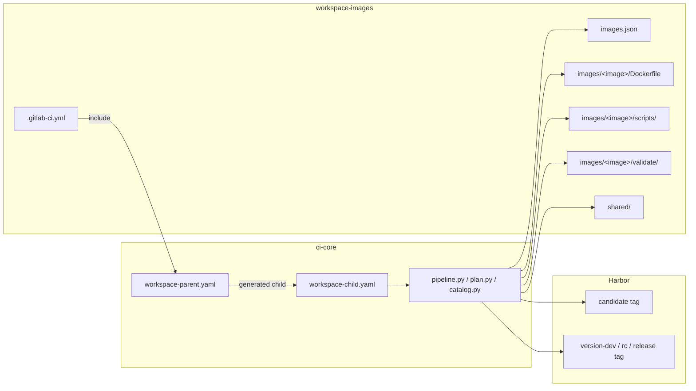
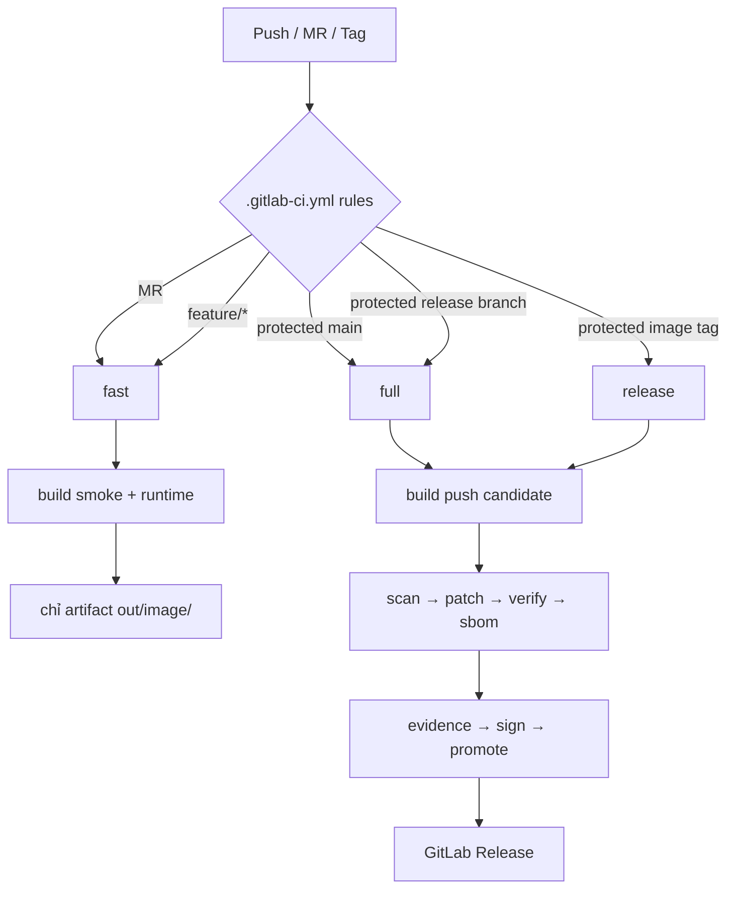
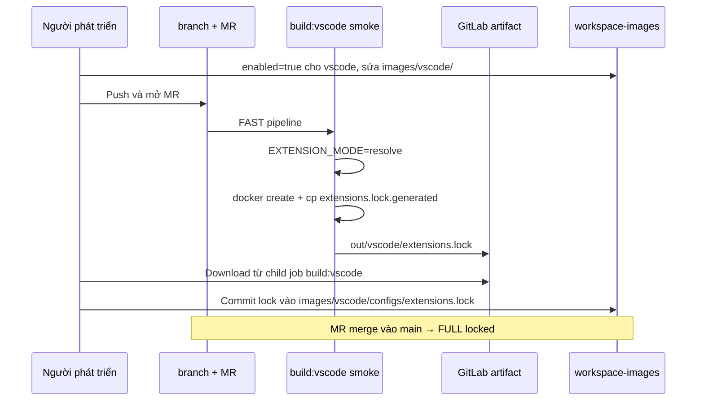

# Workspace Images

> Consumer repo cho pipeline `ci-core`: định nghĩa image inventory, Dockerfile, runtime hook và cách pipeline được trigger. Thuật ngữ chuyên ngành giữ tiếng Anh; phần hướng dẫn viết bằng tiếng Việt.

## 1. repo này làm gì

`workspace-images` là **nguồn sản phẩm build**:

- `images.json` — catalog image: ID, version, trạng thái enable, extension lock metadata, runtime check.
- `images/<image>/` — Dockerfile, script cài đặt, config và validate script của từng image.
- `shared/` — file dùng chung mà nhiều image khai báo `depends_on`.
- `.gitlab-ci.yml` — workflow rules; include parent template từ `ci-core`.

Repo này **không chứa engine pipeline**. Engine nằm ở [`ci-core`](../ci-core) (hoặc project GitLab/GitHub tương ứng). Khi push/MR/tag, `.gitlab-ci.yml` gọi vào `ci-core` để chạy FAST hoặc FULL/RELEASE pipeline.



## 2. Cấu trúc thư mục

```text
workspace-images/
├── .gitlab-ci.yml             # workflow rules + include ci-core
├── images.json                # image inventory, version, enable, hooks
├── shared/                    # content dùng chung giữa các image
│   └── browser/
│       ├── cleanup.sh
│       └── ublock_extension.json
└── images/
    ├── ubuntu/
    │   ├── Dockerfile
    │   ├── scripts/           # install scripts theo từng công cụ
    │   └── validate/          # runtime validation hooks (nếu có)
    ├── chrome/
    ├── chrome-gpu/
    ├── firefox/
    ├── opera-browser/
    ├── tor-browser/
    └── vscode/
        ├── Dockerfile
        ├── configs/
        │   ├── extensions.txt      # danh sách extension ID
        │   └── extensions.lock     # pin phiên bản extension
        ├── scripts/
        │   └── install-extensions.sh
        └── validate/
            ├── runtime.sh
            └── verify-extensions.sh
```

### 2.1 Nhiệm vụ từng loại file

| File / thư mục | Nhiệm vụ |
|---|---|
| `.gitlab-ci.yml` | Quyết định `PIPELINE_KIND` theo MR/push/protected branch/release tag; khai báo `CI_CORE_PROJECT`, `CI_CORE_REF`. |
| `images.json` | Nguồn sự thật cho catalog. Mỗi image có version độc lập. |
| `images/<id>/Dockerfile` | Định nghĩa image. Context build mặc định là root repo. |
| `images/<id>/scripts/` | Script cài đặt/custom startup. Được Dockerfile COPY/execute. |
| `images/<id>/validate/runtime.sh` | Runtime check do catalog trỏ tới (`runtime_check`). Chạy trong container ở network none. |
| `images/<id>/configs/` | Config tĩnh hoặc lockfile do image sử dụng. |
| `shared/` | Nội dung dùng chai; image phải khai báo `depends_on` nếu COPY từ `shared/...`. |

## 3. `images.json`

Mỗi entry là một object. Các trường được engine validate:

| Field | Bắt buộc | Ý nghĩa |
|---|---:|---|
| `id` | Có | ID image, dạng `[a-z0-9._-]`. Dùng cho job name và `out/<id>/`. |
| `repository` | Có | Repository trong Harbor project. Phải khác nhau giữa các image. |
| `version` | Có | Semantic version `X.Y.Z`, độc lập cho từng image. Không suy ra từ git tag chung. |
| `enabled` | Có | `true`/`false`. Catalog chỉ build image enabled. |
| `context` | Có | Hiện phải là `"."`. |
| `dockerfile` | Có | Hiện phải là `images/<id>/Dockerfile`. |
| `platform` | Có | Hiện là `linux/amd64`. |
| `depends_on` | Có | Danh sách shared dependency để selective rebuild và validate COPY hợp lệ. |
| `extension_lock` | Tùy image | Manifest, lockfile và path generated bên trong image (ví dụ VS Code). |
| `runtime_check` | Không | Đường dẫn script validate trong repo, chạy trên image đã build. |

Ví dụ một entry VS Code:

```json
{
  "id": "vscode",
  "repository": "vscode",
  "context": ".",
  "dockerfile": "images/vscode/Dockerfile",
  "platform": "linux/amd64",
  "enabled": false,
  "version": "0.1.0",
  "depends_on": [],
  "extension_lock": {
    "manifest": "images/vscode/configs/extensions.txt",
    "lock": "images/vscode/configs/extensions.lock",
    "generated": "/opt/dwf-vscode/extensions.lock.generated"
  },
  "runtime_check": "images/vscode/validate/runtime.sh"
}
```

## 4. Cách trigger pipeline

`.gitlab-ci.yml` quyết định mode:

| Sự kiện | Mode | Ghi chú |
|---|---|---|
| Merge request | `fast` | Build/runtime local, không push/sign/promote. |
| Push/web `feature/*`, `bugfix/*`, `hotfix/*` | `fast` | Chọn image bị diff ảnh hưởng. |
| Push/web protected `main` | `full` | Build tất cả image `enabled=true`. |
| Protected branch `release/<image>/vX.Y.Z` | `full` | Chỉ đúng image, tag `{version}-rc`. |
| Protected tag `<image>/vX.Y.Z` hoặc `release/<image>/vX.Y.Z` | `release` | Immutable tag `{version}` + GitLab Release. |

Tag/branch phải khớp `version` trong `images.json`. `IMAGE_SELECTION` chỉ override khi Run pipeline, không đặt cố định ở Project Variables.



## 5. Tag và artifact

Version trong `images.json` sinh stable tag:

- `main` protected: `{version}-dev`
- release branch protected: `{version}-rc`
- image tag protected: `{version}`

Trước khi có stable tag, build tạo candidate tag duy nhất `ci-p<parent-pipeline>-<commit>`. Scan, SBOM, runtime, sign và promote theo **immutable digest**, không theo tag mutable.

Artifact quan trọng nằm ở `out/<image-id>/`:

| Artifact | Nội dung |
|---|---|
| `build-metadata.json` / `built.txt` | Digest candidate sau build push. |
| `scan.json` | Trivy scan lần đầu, dùng để chọn OS package vá được. |
| `patch.json` | Digest và trạng thái sau patch. |
| `verified.txt` | Immutable digest được chấp nhận để gate tiếp. |
| `verify.json` | Trivy gate trên digest đã verified. |
| `runtime.json` | Kết quả runtime check. |
| `sbom.cdx.json` | CycloneDX SBOM. |
| `evidence.json`, `provenance.json` | Evidence bundle + SLSA predicate. |
| `promotion.json` | Tag đã promote trên Harbor. |

## 6. VS Code extension lock

VS Code có quy trình riêng vì `extensions.lock` phải được tạo bằng cách cài extension thật.

- `images/vscode/configs/extensions.txt` — manifest extension ID.
- `images/vscode/configs/extensions.lock` — pin phiên bản. Ban đầu có thể chỉ là comment.
- FULL/RELEASE strict: lock phải khớp đúng toàn bộ manifest.
- FAST trên development branch: engine build `EXTENSION_MODE=resolve`, trích lock từ image local vào `out/vscode/extensions.lock`, rồi chạy runtime check resolve mode.

Quy trình đóng lock:



Cách tải artifact:

1. Mở pipeline → chọn **child pipeline**.
2. Vào job `build:vscode`.
3. Trong khối **Assets / Artifacts**, chọn artifact và bấm **Download** (thường là file `.zip`).
4. Giải nén, lấy `out/vscode/extensions.lock`.
5. Review nội dung, commit vào repo và cập nhật MR.

Nếu job failed sau khi đã upload, artifact thường vẫn còn trong tab Assets của job.

## 7. Thêm hoặc sửa image

Quy trình đề xuất:

1. Tạo branch `feature/<image>` hoặc `bugfix/<image>`.
2. Thêm/sửa `images/<id>/Dockerfile`, scripts, config, validate.
3. Cập nhật `images.json`:
   - `id`, `repository`, `version` đúng quy ước.
   - `enabled` chỉ bật khi image đã sẵn sàng; VS Code phải có lock hợp lệ.
   - `depends_on` liệt kê đầy đủ shared file được COPY.
4. Mở MR. FAST chỉ build image bị ảnh hưởng.
5. Khi merge vào protected `main`, FULL build tất cả image enabled và promote `-dev`.
6. Muốn phát hành bản ổn định: protected branch `release/<id>/vX.Y.Z` → RC; protected tag `<id>/vX.Y.Z` → production immutable.

Quy tắc bắt buộc:

- Không hardcode proxy trong Dockerfile hay script. Dùng GitLab CI/CD Variables.
- Không dùng tag `latest` cho production.
- Không thêm secret vào Dockerfile/build args/file config.
- Không sửa `/etc/docker/daemon.json` hay runner config từ repo này.

## 8. Test cục bộ

Test engine: xem [`ci-core` README](../ci-core/README.md#7-test-cục-bộ).

Test nhanh một image (không chạy toàn bộ pipeline):

```bash
cd workspace-images
docker build -f images/ubuntu/Dockerfile -t workspace-ubuntu-test .
docker run --rm workspace-ubuntu-test <command-cần-kiểm>
```

Nếu image có `validate/runtime.sh`, nên chạy qua engine để đúng môi trường (`--network none`, user 1000) thay vì tự quan sát.

## 9. Biến môi trường cần cấu hình

Cấu hình trong GitLab **CI/CD Variables** của project consumer:

| Variable | Bắt buộc | Ý nghĩa |
|---|---:|---|
| `CI_CORE_PROJECT` | Có | Project chứa core. |
| `CI_CORE_REF` | Có | Tag/branch core; khớp include. |
| `HARBOR_REGISTRY` | Có | Registry host. |
| `HARBOR_PROJECT` | Có | Harbor project. |
| `HARBOR_USER`, `HARBOR_PASSWORD` | Protected/release | Robot push/API. |
| `COSIGN_PRIVATE_KEY`, `COSIGN_PASSWORD` | Sign/release | Khóa Cosign. |
| `HTTP_PROXY`, `HTTPS_PROXY`, `NO_PROXY` | Môi trường cần | Chỉ truyền qua biến. |
| `BUILDX_BUILDER_NETWORK` | Không | Escaping test kết nối; mặc định rỗng. |

## 10. Lỗi thường gặp

| Triệu chứng | Nguyên nhân thường gặp | Hướng xử lý |
|---|---|---|
| FAST báo `extensions.lock` thiếu/thừa ID | Lock chưa hợp lệ, đang resolve | Xem artifact, commit lock rồi cập nhật MR. |
| FULL báo lock không hợp lệ | LOCK chưa được commit | FULL luôn strict; không tắt gate. |
| Job pull image internal DNS timeout | Runner/BuildKit resolver không tới registry | Kiểm tra runner/DinD DNS; `BUILDX_BUILDER_NETWORK` chỉ là escape hatch, không hardcode DNS. |
| Không thấy artifact | Đang ở parent pipeline hoặc job chưa upload | Vào đúng child job `build:<image>`; job failed sau upload vẫn có tab Assets. |
| `.ci-tools` không khớp template | `CI_CORE_REF` khác `include.ref` | Đồng bộ hai biến/include. |

## 11. Tham khảo

- Engine, planner, script và test: repo [`ci-core`](../ci-core)
- Chi tiết vận hành: [`../ci-core/docs/PIPELINE_GUIDE_VI.md`](../ci-core/docs/PIPELINE_GUIDE_VI.md)
